# Vortex-Induced Piezoelectric Energy Harvester for Land Vehicles

R&D internship project (2024), École Polytechnique d'Agadir.
Subject of the Moroccan patent application **MA66624** ([details](#patent-application)).

## Idea
When a vehicle moves, air flows along its body. A vortex generator on the roof or rear spoiler
makes the flow separate and shed vortices. The vortices make an elastic support vibrate, and
piezoelectric discs turn those vibrations into electricity for on-board sensors or a battery.

Vortex-induced vibration harvesters already exist for rivers, oceans, tunnels and aerospace.
The prior art reviewed did not cover harvesting this energy on moving land vehicles.

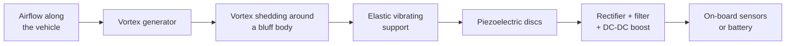

## Prototype
- **Vortex generator** (70 × 90 × 100 mm) designed in **Fusion 360** and 3D-printed in PLA
- **Harvester**: two 35 mm piezoelectric discs in series on a vibrating support, with a bluff body
- **Conditioning circuit**: DB107 diode bridge, filter capacitor, DC-DC step-up converter

| Vortex generator | Final assembly |
|---|---|
|  | 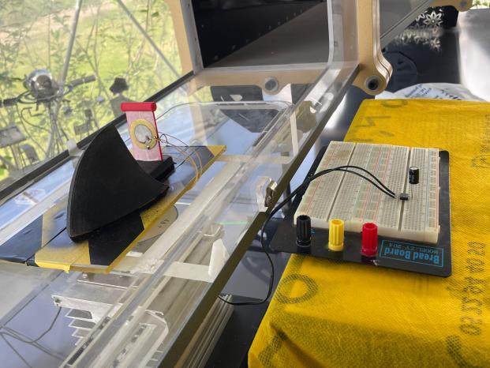 |

| Rectangular body | Cylindrical body | Vibrating support | Piezo disc on support |
|---|---|---|---|
| 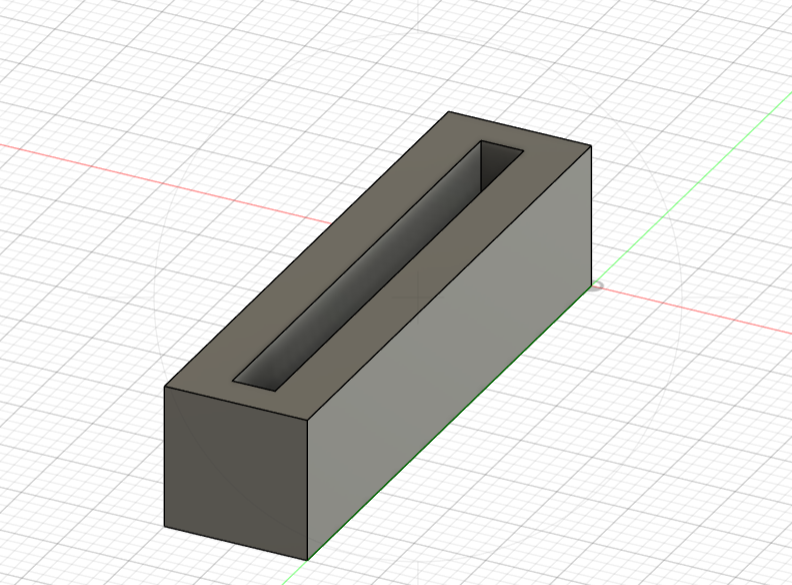 | 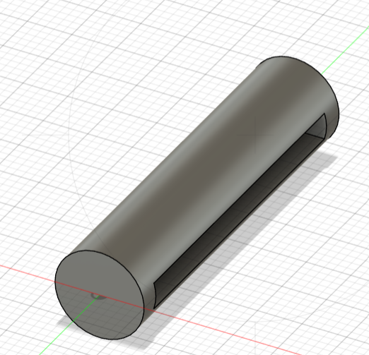 | 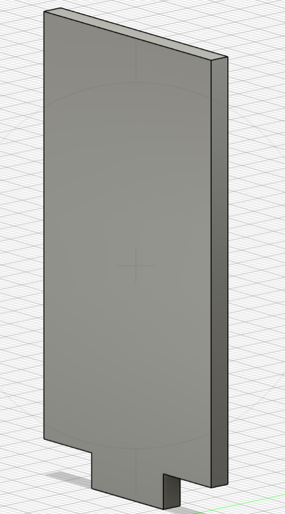 | 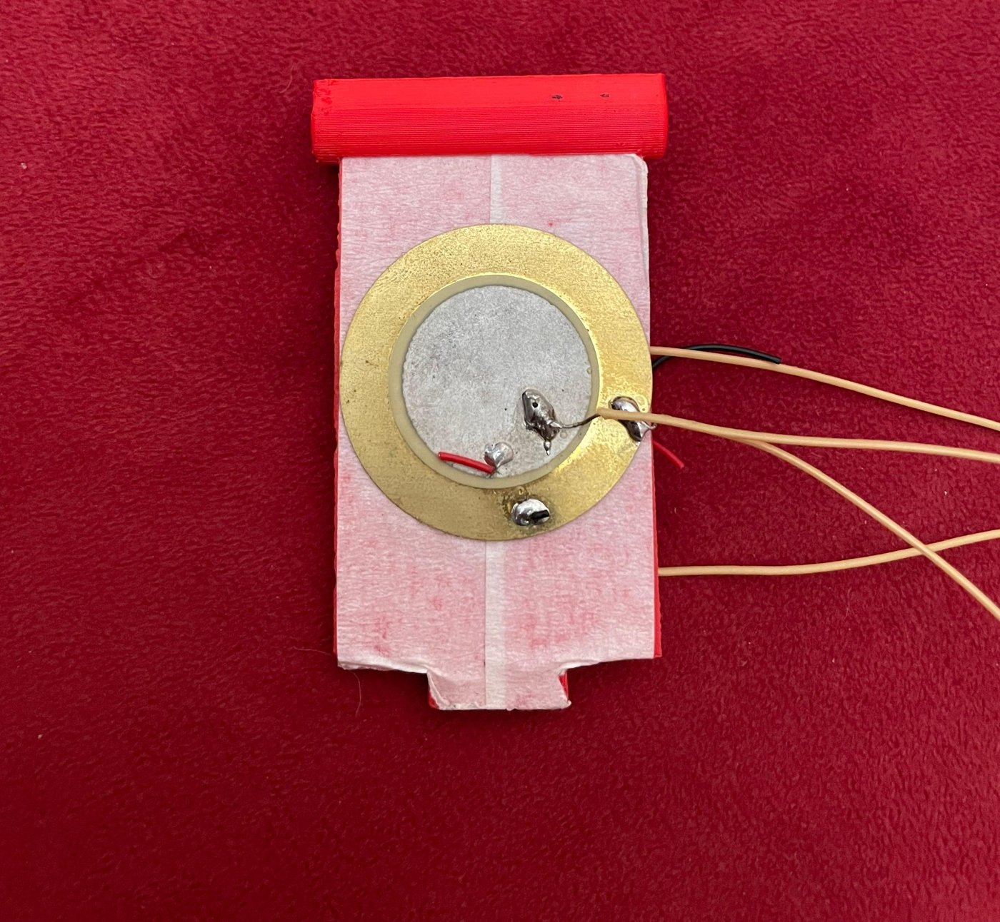 |

## Tests
Wind tunnel from 450 to 1500 fan rpm, comparing **3 support materials** (Plexiglas, PVC, PLA) and
**2 bluff-body shapes** (rectangular, cylindrical). Each configuration was run twice: 144 readings
in [data/wind_tunnel.csv](data/wind_tunnel.csv).

| Test close-up | Test section with conditioning circuit |
|---|---|
| 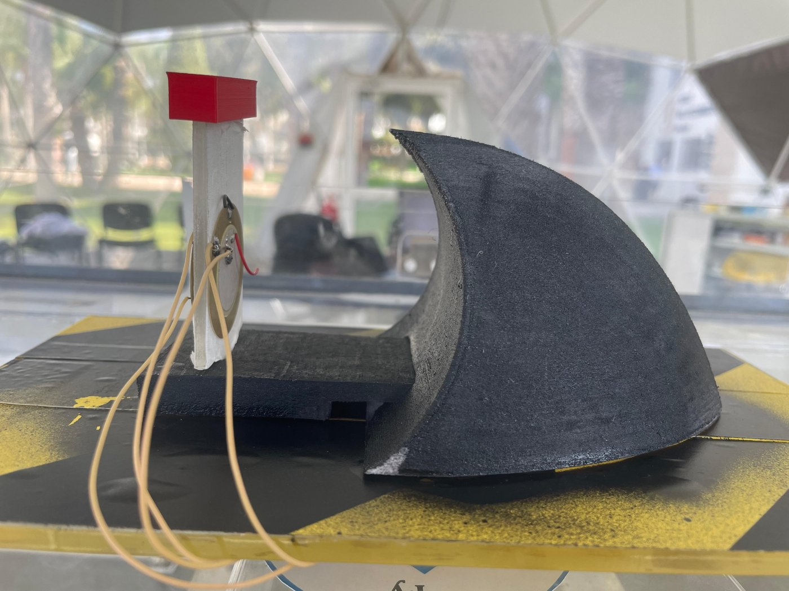 | 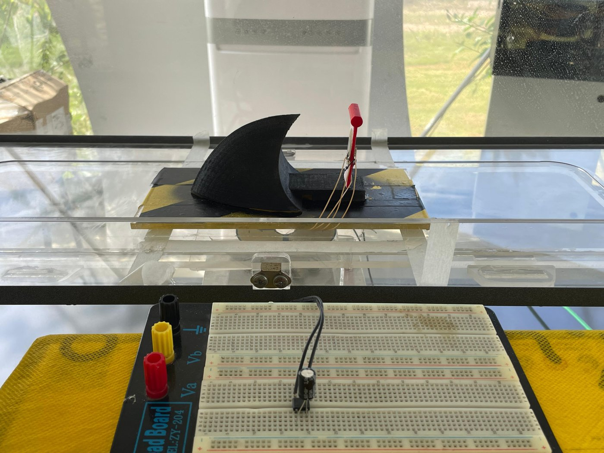 |

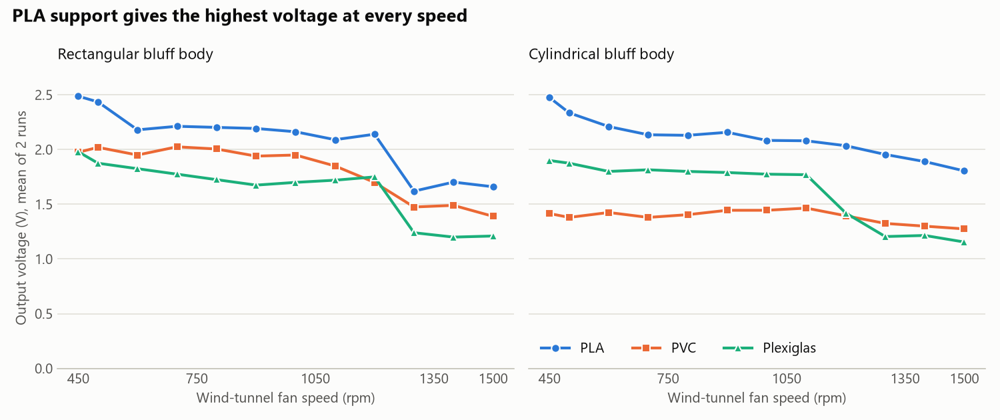

Peak output voltage (best of 2 runs):

| Bluff body | PLA | PVC | Plexiglas | PLA vs PVC | PLA vs Plexiglas |
|---|---|---|---|---|---|
| Rectangular | **2.515 V** | 2.24 V | 2.00 V | +12.3 % | +25.8 % |
| Cylindrical | **2.525 V** | 1.61 V | 1.95 V | +56.8 % | +29.5 % |

- The PLA support gave the highest mean voltage at every speed, for both shapes.
- With PLA, voltage peaked at the lowest fan speed (450 rpm) and fell as speed increased.

## Patent application
| | |
|---|---|
| Number | **MA66624** (OMPIC, Morocco) |
| Filing date | 25 July 2024 |
| Title | *Dispositif de récupération d'énergie électrique sur véhicules terrestres par générateurs de vortex associés aux collecteurs piézoélectriques* |
| Applicant | Université Internationale d'Agadir (Universiapolis) |
| Inventors | Mohamed Maine, Souhail Benhmad, Boujemaa Nassiri |

**Description.** Vortex generators mounted on the roof, rear fenders or another suitable place on a
vehicle make the airflow separate. The resulting vortices make an elastic structure oscillate, and
the attached piezoelectric elements turn this motion into electricity.

**Claims in short (12).**
- Device: at least one vortex generator, a piezoelectric collector, an assembly support, mounting
  supports and a conditioner (claim 1)
- Vortex generator: placement on the vehicle, shape and angle of its downstream face (2-3)
- Collector: bluff body of various shapes, elastic vibrating structure, piezoelectric material (4-6)
- Arrays of adjacent devices, connected in series or parallel (7-8)
- T-shaped assembly support, removable, with fixings adaptable to different car bodies (9-12)

| Fig. 1 On the vehicle | Fig. 2 Generator and collector | Fig. 3 Collector and conditioner |
|---|---|---|
| 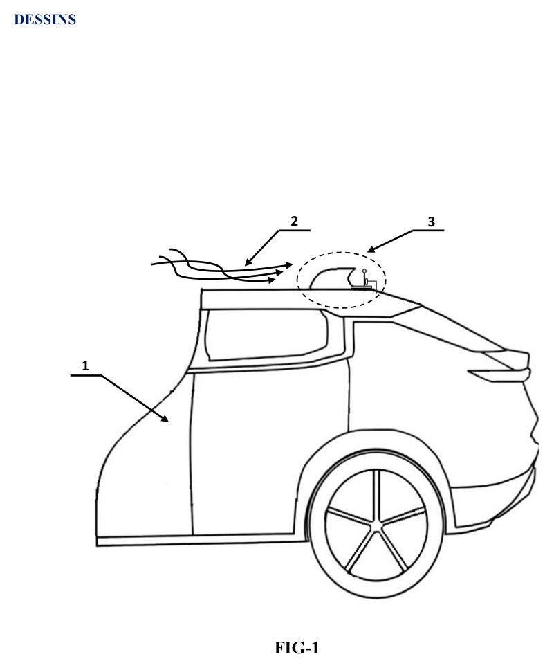 | 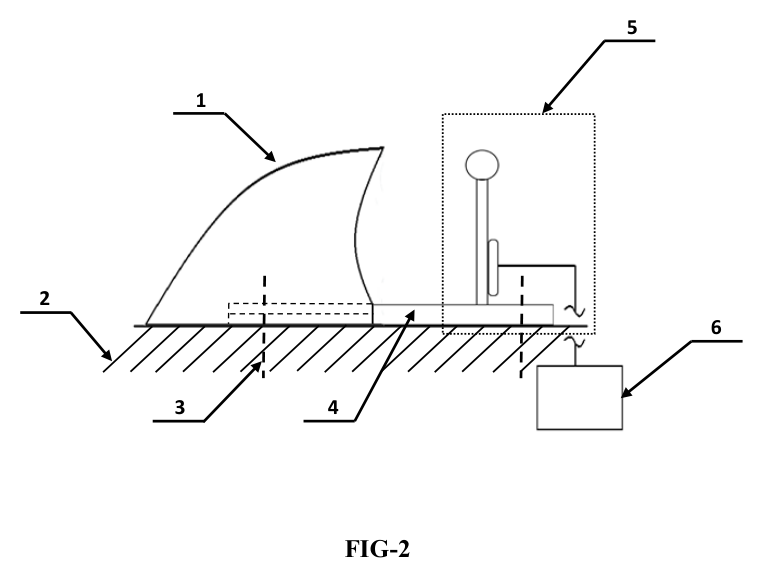 | 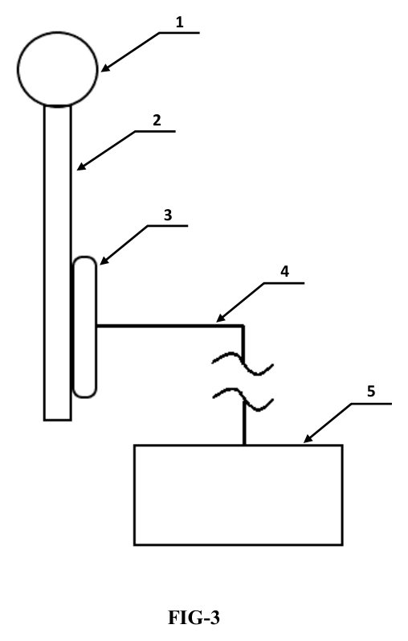 |
| **Fig. 4 Operation** | **Fig. 5 Array, top view** | **Fig. 6 Block diagram** |
| 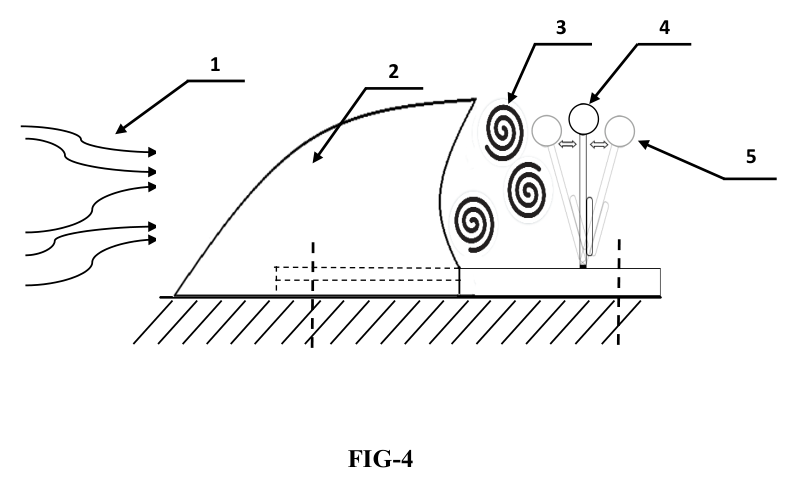 | 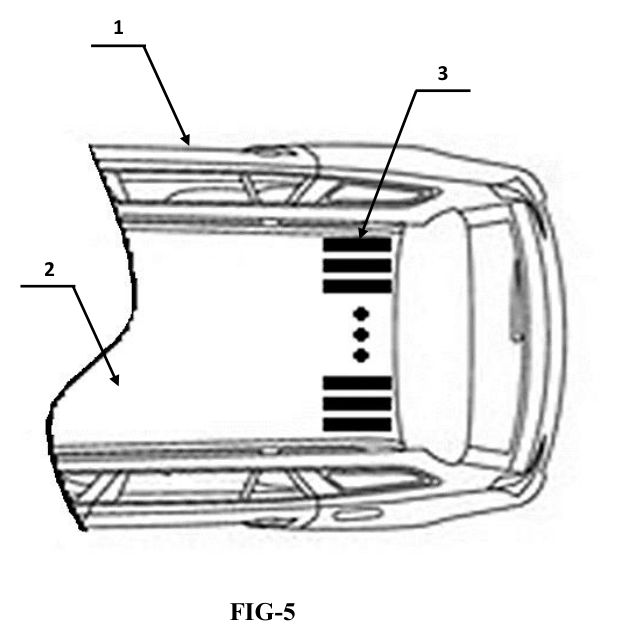 | 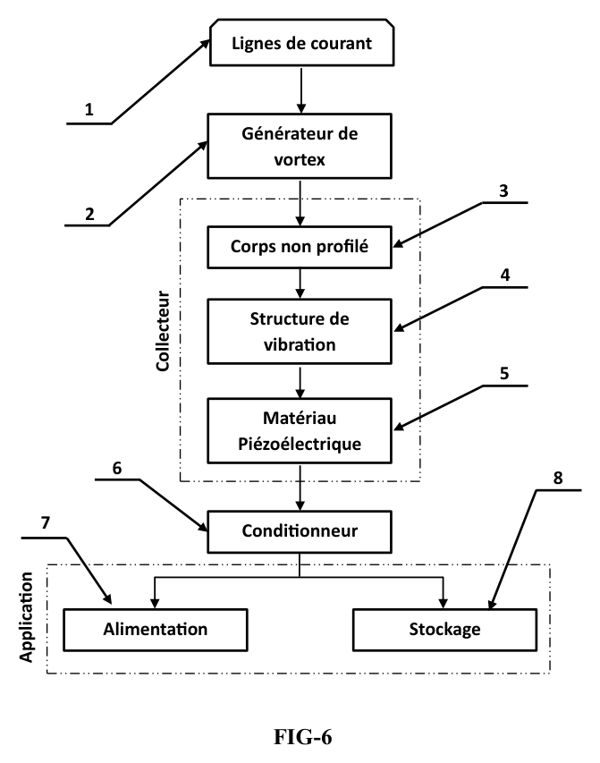 |

Full application text (French): [MA66624_application_fr.pdf](patent/MA66624_application_fr.pdf)

## Stack
Fusion 360 · 3D printing · Piezoelectric harvesting · Power conditioning · Wind-tunnel testing · Patent writing
