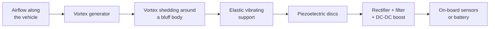
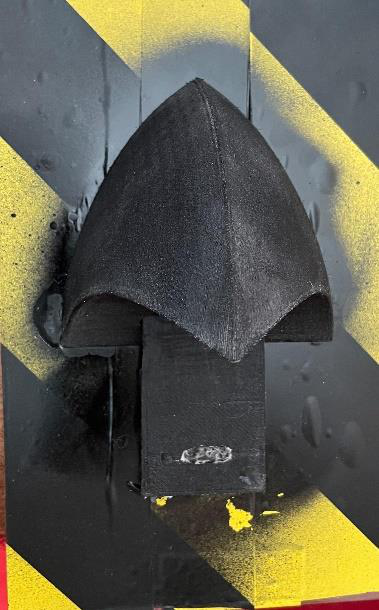
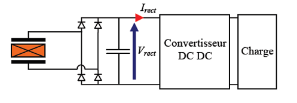

# Vortex-Induced Piezoelectric Energy Harvester for Land Vehicles

R&D internship project (2024), École Polytechnique d'Agadir.
Subject of the Moroccan patent application **MA66624**.

## Idea
When a vehicle moves, air flows along its body. A vortex generator on the roof or rear spoiler
makes the flow separate and shed vortices. The vortices make an elastic support vibrate, and
piezoelectric discs turn those vibrations into electricity for on-board sensors or a battery.

Vortex-induced vibration harvesters already exist for rivers, oceans, tunnels and aerospace.
The prior art reviewed did not cover harvesting this energy on moving land vehicles.

## Prototype
- **Vortex generator** (70 × 90 × 100 mm) designed in **Fusion 360** and 3D-printed in PLA
- **Harvester**: two 35 mm piezoelectric discs in series on a vibrating support, with a bluff body
- **Conditioning circuit**: DB107 diode bridge, filter capacitor, DC-DC step-up converter

| Vortex generator | Final assembly |
|---|---|
|  |  |

## Tests
Wind tunnel from 450 to 1500 rpm, comparing **3 support materials** (Plexiglas, PVC, PLA) and
**2 bluff-body shapes** (rectangular, cylindrical). Each configuration was repeated for repeatability.

| Bluff body | Best support | Output voltage | vs Plexiglas | vs PVC |
|---|---|---|---|---|
| Rectangular | PLA | **2.515 V** | +20.5 % | +10.9 % |
| Cylindrical | PLA | **2.525 V** | +22.7 % | +36.2 % |

The PLA support gave the best output for both shapes.

## Stack
Fusion 360 · 3D printing · Piezoelectric harvesting · Power conditioning · Wind-tunnel testing · Patent writing
